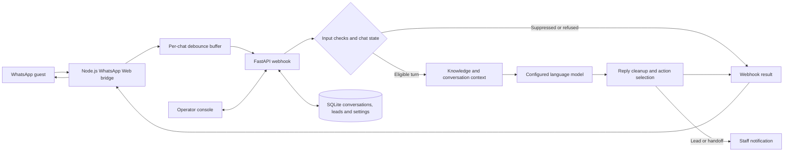

# Hospitality AI Agent

A WhatsApp guest assistant for campground and accommodation operators, with a browser console for conversation oversight and staff handoff.

The assistant answers routine questions using a property knowledge base, groups fragmented WhatsApp messages into one turn, and flags reservation leads and requests that need a person. Operators can inspect conversation history, change the knowledge base, and pause automated replies.

## Architecture and message pipeline



1. The bridge uses `whatsapp-web.js` and Chromium to maintain the WhatsApp Web session. Incoming messages reset a per-chat timer, whose initial window is 30 seconds and can be changed in the dashboard.
2. The backend checks chat state, rate limits, and message safety before generation. Eligible turns are assembled with active property knowledge and conversation history.
3. The backend removes internal action tags before sending the reply to the bridge. A reservation lead or staff handoff can trigger an alert and temporarily pause automated replies for the chat.

## Local setup

Use Python 3.10+, Node.js 18+ with npm, and a Chromium installation available to Puppeteer. Start from the repository root in PowerShell.

```powershell
python -m venv .venv
.\.venv\Scripts\python.exe -m pip install -r requirements.txt
npm --prefix bridge ci
Copy-Item .env.example .env
```

Edit `.env` before starting. Set a unique `PANEL_PASSWORD` and choose your model provider. Start FastAPI from `backend/`, where its application imports resolve.

```powershell
Set-Location backend
..\.venv\Scripts\python.exe -m uvicorn main:app --host 127.0.0.1 --port 8000
```

Open the operator console at `http://127.0.0.1:8000/`. The backend attempts to start the installed bridge if it is absent. If running it separately, use `npm --prefix bridge start` from the repository root and start it before FastAPI. Pair a test WhatsApp account using the console's QR or phone pairing flow, then send a message matching the configured trigger prefix. Check `/health` for backend status and the console for bridge and conversation state.

## Configuration

| Setting | Purpose |
| --- | --- |
| `PANEL_PASSWORD` | Dashboard login. Supply your own value before the first start. |
| `LLM_PROVIDER`, `LLM_MODEL`, `LLM_API_KEY` | Provider and model selection. The configuration handles Ollama, OpenAI, Groq, Gemini and OpenRouter. Supply a key for hosted providers. |
| `OLLAMA_BASE_URL` | Local Ollama server address when using Ollama. |
| `TRIGGER_PREFIX` | Bridge test prefix, initially `-test` unless configured otherwise. |
| `DATABASE_PATH`, `AUTH_DATA_PATH` | SQLite state and WhatsApp browser session storage. |
| `BACKEND_WEBHOOK_URL`, `BRIDGE_API_URL` | Internal addresses connecting the bridge and backend. |

The browser session, SQLite database and audit logs can contain credentials or guest data. Keep them private and keep the bridge and webhook on a trusted local network. The deployment guide covers container configuration and operational details. [Environment template](.env.example) · [Deployment guide](DEPLOYMENT.md)

## Code map

| Component | Responsibility |
| --- | --- |
| [WhatsApp bridge](bridge/index.js) | Session pairing, buffering, and delivery |
| [FastAPI app](backend/main.py) | Webhook, model calls, staff handoff, and console endpoints |
| [Guardrails](backend/security.py) and [database](backend/database.py) | Input checks, audit handling and local persistence |
| [Knowledge base](backend/camp_knowledge.txt) and [notifications](backend/notifier.py) | Default property facts and staff alerts |
| [Operator console](frontend/) | Conversation review, filters and configuration |

From `backend/`, run `..\.venv\Scripts\python.exe -m pytest test_unit.py` for the database lifecycle test. Review the [integration test](backend/test_backend.py) before running it against a live local instance.
